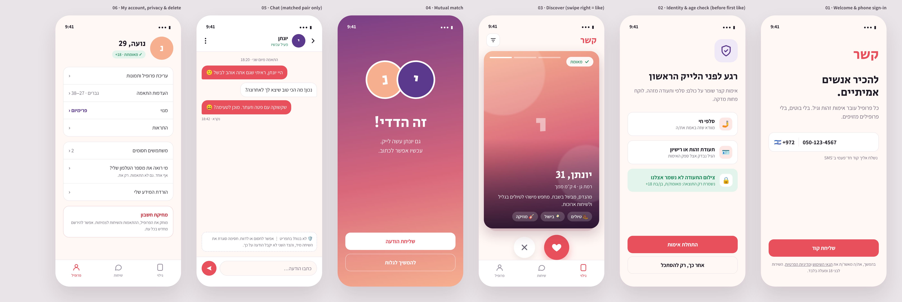
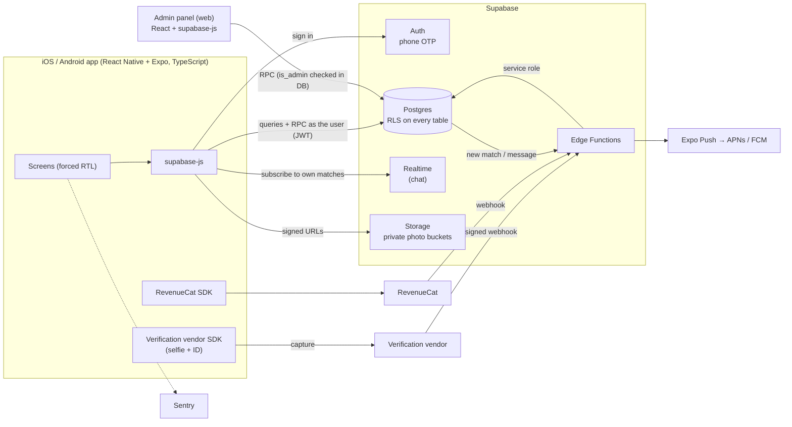
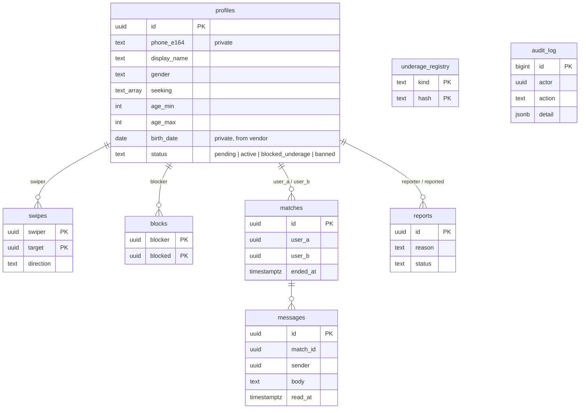
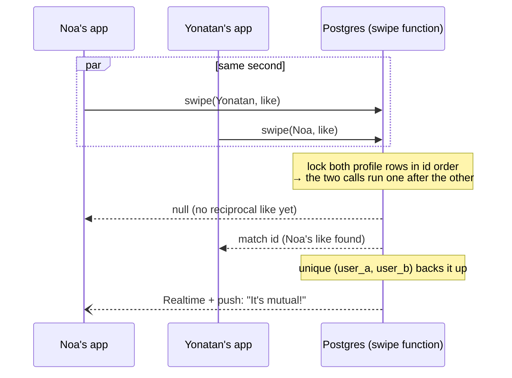
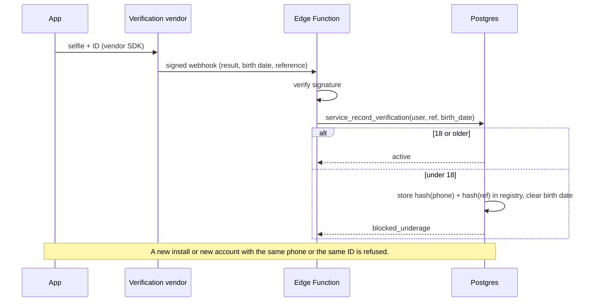

# Architecture

A Hebrew-first (RTL) dating app for iOS and Android with a web admin panel. One developer, one backend, no servers to run.

## System overview

**Rules of the design**
- **The client is never trusted.** The app reads and writes only through row-level security and `security definer` functions that check `auth.uid()`. A modified app, or someone calling the API with their own token, gets the same answers as the real app.
- **Third parties talk to Edge Functions, never to the app.** The verification result and purchase state arrive by signed webhook, are checked, and are written with the service role. The app cannot claim it is verified or premium.
- **Nothing private leaves the database by accident.** Column-level grants keep the phone number, birth date and verification reference unreadable to every app user, including on their own row.

## Data model

`underage_registry` and `audit_log` have no relation to `profiles` on purpose. The first holds only salted hashes, so it survives account deletion. The second is append-only.

## Key flows

### Mutual like, exactly once

### Verification and the under-18 block

Verification runs **right before the first like**, not at sign-up. Unverified users can look around but cannot interact. You pay the vendor per engaged user instead of per download, and onboarding drop-off is lower.

## Security model at a glance

| Asset | Who can read | Who can write | Enforced by |
|---|---|---|---|
| Phone, birth date, verification ref | nobody in the app (backend only) | sign-in / vendor webhook | column grants |
| Profile (name, age, city, bio) | self, the discover deck, matched partner | self via `update_my_profile()` | RLS + functions |
| Likes | self only | `swipe()` | RLS + function |
| Matches | the two people | `swipe()`, `unmatch()`, `block_user()` | RLS + functions |
| Messages | the two people, while the match is active | sender, while active | RLS (also applies to Realtime) |
| Photos | self and matched partner | self | Storage policies + signed URLs |
| Reports | reporter (own reports only), admins | `report_user()` | RLS + functions |
| Audit log | admins | admin functions only, append-only | trigger |

## Environments and delivery

| | Development | Staging | Production |
|---|---|---|---|
| Supabase project | local (`supabase start`) | separate project | separate project |
| App build | Expo dev client | EAS internal / TestFlight | App Store / Google Play |
| Data | `seed.sql` (fictional) | test accounts only | real users |

- **CI:** GitHub Actions runs typecheck and the database test suite on every push. A migration that breaks a rule fails the build.
- **Builds:** EAS Build for both stores and EAS Submit for uploads. EAS Update ships JS-only fixes without a store review, with the runtime version pinned so an update can never reach a binary it wasn't built for.
- **Secrets:** vendor and RevenueCat webhook secrets and the registry salt are kept in Supabase secrets, never in the app bundle.
- **Monitoring:** Sentry for crashes and slow screens, and Supabase logs for function errors.

## Store readiness (dating apps get a closer look)

- **Age rating:** 17+ on iOS and Mature/18+ on Google Play. The 18+ gate is enforced by real verification, not a checkbox.
- **User-generated content (Apple 1.2):** report, block and an in-app path to contact support are on every profile and chat. A moderation queue is reviewed by a person.
- **Account deletion (Apple 5.1.1(v), Google Play):** in-app, and it deletes the data.
- **Privacy:** privacy manifest for every SDK, App Privacy and Data Safety forms filled in from the real data flows above. Location (if used) is coarse, and distance is rounded.
- **Subscriptions:** purchases go through StoreKit and Google Play Billing via RevenueCat. Restore Purchases is visible, and the terms are shown before purchase.
