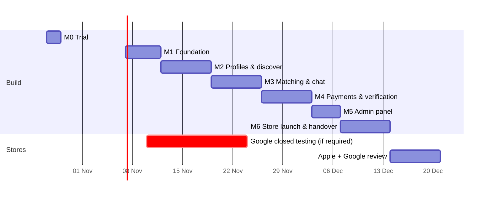

# Roadmap

From access to the prototype to live in both stores in about six weeks. Each milestone ends with an installable build (TestFlight and Google Play internal testing) that the client tests on their own iPhone and Android before it is accepted.

The dates below assume a start on **Tue 27 Oct 2026**.

| | Milestone | Dates | Done when |
|---|---|---|---|
| **M0** | **Trial: swipe deck + RTL** | 27–28 Oct | The swipe deck matches the prototype on a real iPhone and Android: drag, rotate, snap back, fling, like/pass buttons, the next card preloaded, forced RTL from the first screen with mirrored chevrons, and Secular One and Assistant fonts. |
| **M1** | **Foundation** | 29 Oct – 2 Nov | Expo project in the client's GitHub org, TypeScript, Expo Router, EAS Build for both platforms, Sentry, and staging plus production Supabase projects. Phone OTP sign-in works, and the database migrations and CI are running. |
| **M2** | **Profiles & discover** | 3 – 9 Nov | Onboarding (name, gender, seeking, age range, city, bio, photos to private Storage). Edit profile. The discover deck is served by the database with all eligibility rules (orientation both ways, both age ranges, blocks, already-swiped). |
| **M3** | **Matching & chat** | 10 – 16 Nov | Like/pass, mutual match exactly once, the "It's mutual" screen. Realtime chat with read receipts and push notifications. Block, unmatch, report. Hebrew strings sent to the client for review. |
| **M4** | **Payments & verification** | 17 – 23 Nov | Verification vendor integrated before the first like, with the webhook in an Edge Function and the under-18 block tied to phone + ID. RevenueCat subscriptions on both stores, with entitlements written server-side and restore purchases. |
| **M5** | **Admin panel** | 24 – 27 Nov | Web panel: moderation queue (under-18 first), user lookup, ban with a required note, verification review, basic stats, append-only audit log. |
| **M6** | **Store launch & handover** | 28 Nov – 4 Dec | Account deletion, privacy manifest, App Privacy / Data Safety forms, screenshots and store listings in Hebrew, submission to both stores. Handover: README, environment docs, a recorded walkthrough, and all accounts in the client's name. |
| | **Live** | ~11 Dec | After normal Apple and Google review. Review time is not in our control. Dating apps get extra scrutiny, which is why the age, report/block and deletion work is done before submission rather than after a rejection. |

## Risks and how they are handled

| Risk | Handling |
|---|---|
| **Google's 14-day closed test.** New *personal* Play developer accounts must run a closed test with 12+ testers for 14 days before production. | Confirm the account type on day 1. If it applies, start the closed test at M3 (10 Nov) so it finishes before submission. |
| **App Store rejection for a dating app** (age gate, UGC moderation, deletion, misleading subscription terms). | All of these are built in M3–M6 and listed in [ARCHITECTURE.md](ARCHITECTURE.md#store-readiness-dating-apps-get-a-closer-look). |
| **"Blocked on this device" cannot be guaranteed** (no stable device id on iOS, only partly on Android). | The block is anchored to the verified phone and the vendor's identity reference, and the policy text is worded to match what the app can actually do. |
| **Verification vendor cost per signup.** | Verify right before the first like, not at sign-up, so the client pays per engaged user. |
| **Hebrew copy quality.** | Every string lives in one translation file and goes to the client for review before release. Adding English or Russian later means adding a file, not code changes. |

## After launch (not in the fixed scope, quoted separately if wanted)

- Distance filter with coarse location
- "Who liked me" for subscribers
- Daily like limits and boosts
- Photo moderation (automatic nudity check before a photo goes live)
- English / Russian translations
