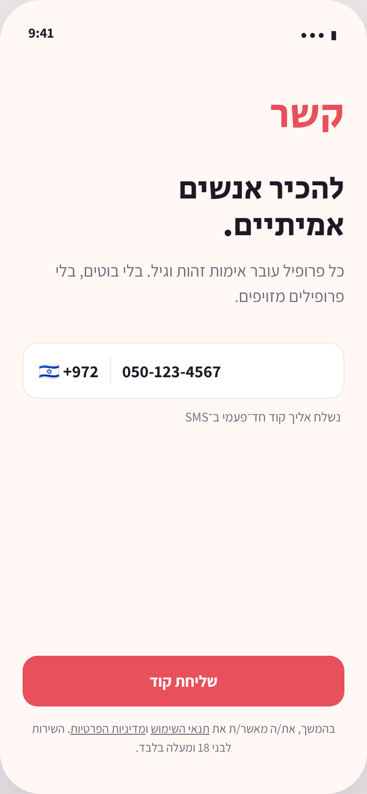
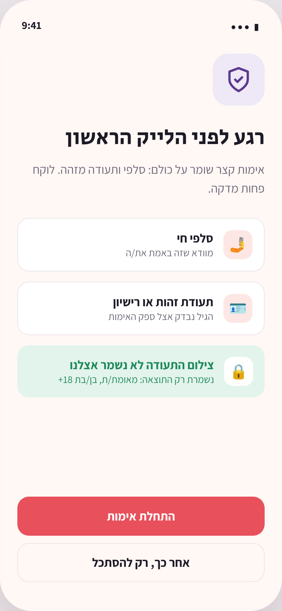
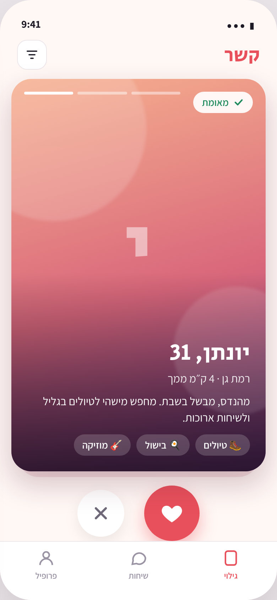
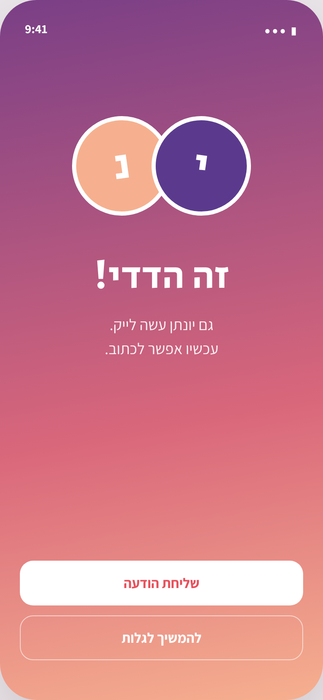
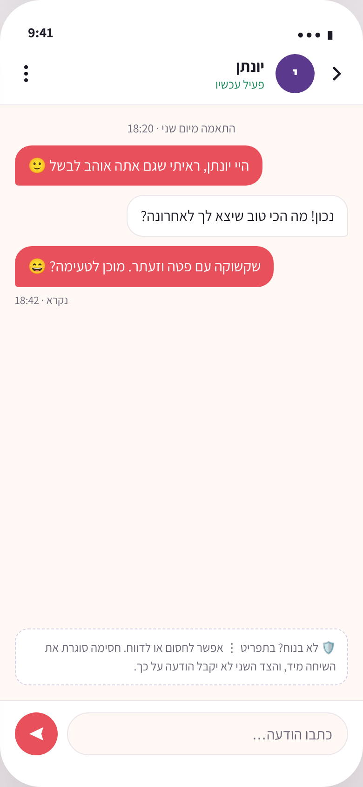
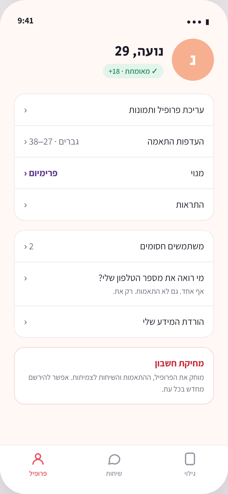
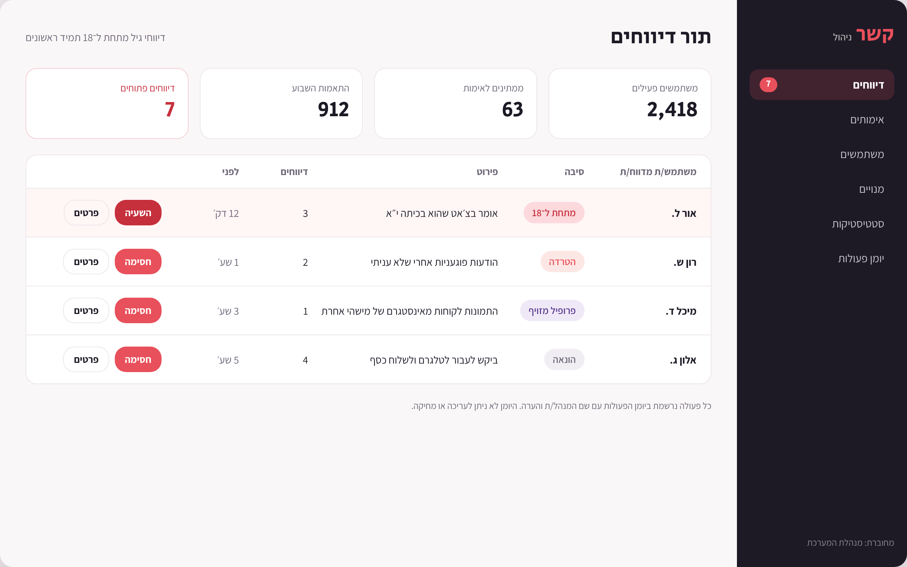

# Screen designs

Design mockups for a Hebrew-first (RTL) dating app. They are pictures of the intended screens, not app code. The brand name "קשר" is a placeholder. Fonts: Secular One (headings) and Assistant (body). The photos are placeholders: no real people.

| | |
|---|---|
|  **01 Welcome & phone sign-in.** Phone OTP; 18+ stated up front. |  **02 Verification before the first like.** Selfie + ID; only the result is stored. |
|  **03 Discover.** Swipe right = like, even in RTL. "Verified" badge on every card. |  **04 Mutual match.** Created once, by the database. |
|  **05 Chat.** RTL bubbles (mine on the left). Block/report one tap away. |  **06 Account.** Phone never shown to anyone; in-app account deletion. |

**07 Admin panel.** Moderation queue with under-18 reports always first; every action is audited.
